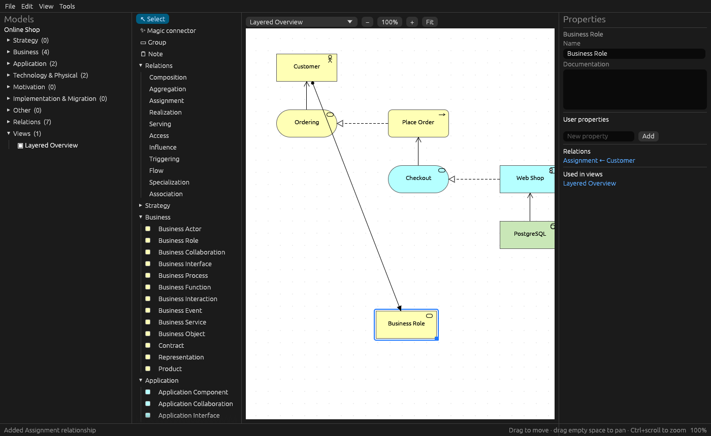
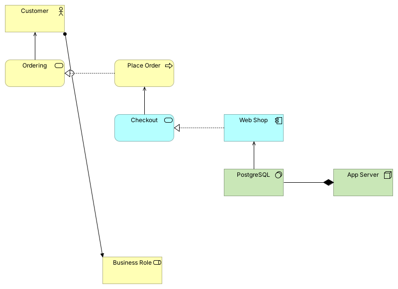

# archimate-rs

An ArchiMate 3.2 modelling tool in Rust, modelled on [Archi](https://www.archimatetool.com).
It reads and writes Archi's own `.archimate` files, so you can move models back and forth between the two tools.



## What's here

| Crate | What it does |
|---|---|
| `archimate-core` | Library with the ArchiMate 3.2 metamodel (61 element types, 11 relationship types), a model that round-trips Archi files, the official relationship rules, a validator and CSV export |
| `archimate-cli` | `archimate` command: `info`, `validate`, `export-csv`, `format`, `new`, `example`, `rules` |
| `archimate-studio` | Desktop editor built with egui. It has a model tree, a palette, a diagram canvas and a properties panel |

### Desktop editor (`archimate-studio`)
- Open and save `.archimate` files (Ctrl+S). Undo and redo with Ctrl+Z / Ctrl+Y.
- Model tree organised by folder. Drag an element from the tree onto a view, and its existing relationships are drawn automatically.
- Palette with every ArchiMate element, plus Group, Note and all relationship types.
- **Magic connector**: drag between two elements and you are offered only the relationships ArchiMate allows between them. A specific relationship tool refuses invalid connections and tells you which ones are allowed.
- Move, resize and nest elements (drop one inside another, like Archi). Zoom with Ctrl+scroll, pan by dragging empty space, and use Fit.
- Archi-style notation: layer colours, shapes, corner icons, and line and arrow styles per relationship type.
- Properties panel: name, documentation, user properties, access type, and fill colour per view object. It also lists an element's relations and the views it appears in.
- Validation window (Tools › Validate) that links each issue to the object it is about.

### Compatibility with Archi
- The file format matches Archi: Archi's own template round-trips **byte-for-byte**, and a model saved by this tool is re-saved by Archi 5.10 unchanged.
- Anything not modelled here (sketch and canvas views, profiles, images, styling attributes) is kept as-is.
- `scripts/check-with-archi.sh` runs that check against a real Archi install (headless, works in CI).



*The example model's view, rendered by Archi 5.10 from a file this tool wrote.*

## Build and run

```bash
cargo run -p archimate-studio -- path/to/model.archimate   # desktop app (opens an example if no file is given)
cargo run -p archimate-cli -- example shop.archimate
cargo run -p archimate-cli -- validate shop.archimate --strict
cargo run -p archimate-cli -- rules BusinessActor BusinessRole
cargo test --workspace
```

On Linux the desktop app needs the usual X11/Wayland libraries (`libxkbcommon-x11-0`, plus Vulkan or OpenGL drivers).

## Not done yet
- Zipped `.archimate` archives (models with embedded images), sketch and canvas editing, viewpoints, specializations/profiles
- Bendpoints are kept but drawn as straight lines. There is no label positioning and no fonts per object
- Open Group Exchange Format, CSV import, reports, scripting, and collaboration (coArchi-style git)
- Copy/paste, multi-select, align/distribute, printing and image export

## Credits
The relationship table `crates/archimate-core/data/relationships.xml` comes from Archi (MIT licence, © Phillip Beauvoir, Jean-Baptiste Sarrodie, The Open Group). See `data/ARCHI-LICENSE.txt`. The rest of the code was written from scratch.
